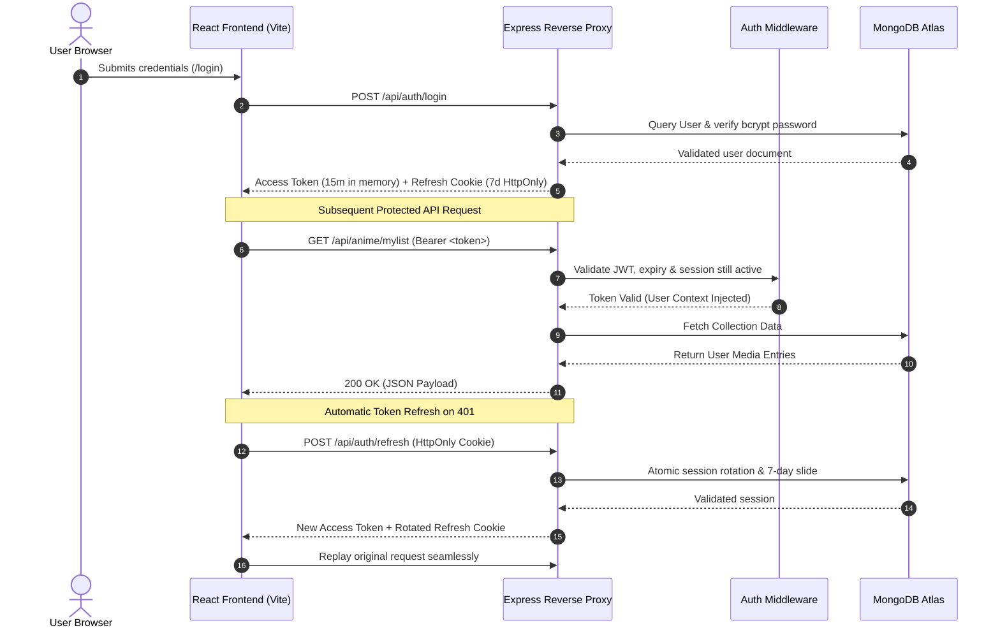
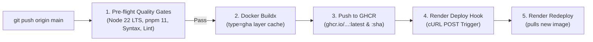

# Kokuyo Obsidian (黒曜) - Personal Media Tracker

[](https://github.com/swagatgharat/KokuyoObsidianOfficial/actions/workflows/deploy.yml)
[](https://github.com/swagatgharat/KokuyoObsidianOfficial/pkgs/container/kokuyoobsidianofficial)
[](https://github.com/swagatgharat/KokuyoObsidianOfficial/pkgs/container/kokuyoobsidianofficial)
[](https://kokuyoobsidian.onrender.com)
[](https://react.dev/)
[](https://vite.dev/)
[](https://expressjs.com/)
[](https://www.mongodb.com/)
[](https://nodejs.org/)
[](https://pnpm.io/)

Kokuyo Obsidian (黒曜) is an enterprise-grade, unified media tracking and community curation platform engineered to organize and monitor Anime, Manga, Movies, TV Series, Books, and Games within a single synchronized dashboard. Built on a resilient pnpm workspace monorepo, it unifies a React 19 Single Page Application with an Express 5 REST API, featuring bi-directional linked progress steppers, sliding 7-day session rotation, canvas hardware fingerprinting, multi-currency regional billing, and automated multi-stage container deployments.

## Links

- **Live Demo**: [https://kokuyoobsidian.onrender.com](https://kokuyoobsidian.onrender.com)

## Image


---

## 1. Project Overview

**Kokuyo Obsidian** (Japanese for *Obsidian*) delivers a centralized, high-performance ecosystem for cataloging and monitoring an individual's digital leisure life. By eliminating fractured tracking experiences across fragmented web services, Kokuyo Obsidian consolidates multimedia progress, scoring benchmarks, editorial reviews, and social interactions into an elegant, reactive user interface backed by automated cloud workers and multi-source API metadata synchronization.

### Problem Solved

Traditional media consumption tracking is severely fragmented—requiring separate accounts across MyAnimeList/AniList (anime/manga), Letterboxd/TMDB (movies/cinema), Trakt/TV Time (television), Goodreads/StoryGraph (literature), and Backloggd/IGDB (gaming). This fragmentation results in:
- **Disjointed Progress Management**: Juggling multiple tabs, conflicting scoring scales, and fractured activity histories.
- **Manual Data Re-Entry**: Inability to cross-reference related franchises across media types or bulk-migrate collections via universal multi-sheet formats.
- **Account Sharing & Trial Abuse**: Vulnerability of subscription platforms to duplicate free-trial exploitation, script-driven spam, and credential reuse across unmonitored devices.
- **Infrastructure Overhead & Cold-Starts**: Complex multi-service deployments incurring high server hosting costs, cross-origin resource sharing (CORS) latency, and container sleep cycles on free-tier infrastructure.

Kokuyo Obsidian solves these challenges by consolidating all six media categories around one shared catalog with per-category tracking lists, introducing bi-directional linked progress steppers, enforcing fail-closed device fingerprinting at registration, and deploying both frontend and backend within a single multi-stage Alpine container.

### Target Users

- **Media Enthusiasts & Otakus**: Power users tracking extensive libraries across anime, manga, literature, gaming, movies, and series with granular progress tracking and linked steppers.
- **Curators & Collectors**: Organizers who assemble custom multi-category playlists with drag-and-drop reordering. Administrators can bulk import and export collections and the catalog via Excel.
- **Social Trackers & Community Members**: Friends sharing libraries via invite links, copying catalog items with 1-click import actions, and interacting with community recommendations.
- **Platform Administrators & Hiring Teams**: Auditors evaluating strict enterprise security practices, multi-tier monetization models, sliding session defenses, and automated CI/CD container pipelines.

---

## 2. Core Features

- **Universal Media Tracking & Bi-Directional Linked Steppers**: Granular lifecycle tracking across six distinct entertainment categories (Anime, Manga, Movies, TV Series, Books, and Games) featuring bi-directional linked progress steppers (Season <-> Episode for TV and Volume <-> Chapter for Manga) that automatically synchronize progress counts and status milestones (Watching, Reading, Playing vs. Completed) alongside direct watch/read streaming redirects.
- **Interactive Drag-and-Drop Playlists & Catalog Discovery**: Dynamic multi-category custom playlist curation with native HTML5 drag-and-drop reordering, edge auto-scrolling, real-time index persistence, and multi-source third-party discovery integration (AniList, Jikan, TMDB, Google Books, Open Library, IGDB) with dynamic missing-cover filters and automated background refetching.
- **Typo-Tolerant Fuzzy Search**: A shared frontend/backend scoring engine that forgives typos ("narto" → *Naruto*), punctuation and accents ("spiderman" → *Spider-Man*, "pokemon" → *Pokémon*) and word order, while ranking exact titles first. Sequel and season numbers are matched by value, including roman numerals and ordinals ("final fantasy 7" → *Final Fantasy VII*, "godfather 2" → *Part II*), and titles in any script (Japanese, Hindi, Cyrillic) are searchable. Two-letter searches ("Up", "Oz") match whole words only, never fragments inside other words.
- **Source-Verified Shared Catalog**: Titles are stored once in a shared catalog. New entries are built server-side from the source API's own metadata, never from client input, and surfaced with a *Kokuyō Verified* badge. Titles stay copyable with the mouse while the rest of the interface remains non-selectable.
- **Social Network, Friend Collections & Add-to-Library Sync**: Granular friend connection system utilizing shareable platform ID invites, pending request counters with automated 7-day reminder notifications, mutual collection inspection, and 1-click "Add to Kokuyo Obsidian" metadata cloning that imports catalog entries directly into personal tracking lists.
- **Community Reviews & Reaction-Driven Recommendation Feed**: Public review feeds with score calculations and community recommendation engine allowing users to publish curated suggestions with interactive, mutually exclusive Like/Dislike reactions, live counter synchronization, and role-based moderation.
- **Multi-Tier Subscription & Dynamic Currency Engine**: Flexible subscription tier engine (Rookie, Enthusiast, Otaku, and ₹3 / $0.99 7-day Trial Pass) with automated IP geolocation currency detection (INR ₹ / USD $), admin-configurable Universal USD Markup benchmarking (((INR / 86.5) + markup) with .49/.99 rounding), automated feature limit gates, soft-locking of excess items on plan expiration, and smart dual-payment routing (domestic UPI QR micropayments vs. Dodo Payments global card/checkout). Dodo payments are credited exactly once via signature-verified webhooks or return-page verification, and manual UPI transfers carry the user's Platform ID or email in the payment note so administrators can match them before approval.
- **Enterprise PDF Invoicing & Financial Audit Trail**: Automated transaction dashboard with KPI summaries, live search, and on-demand browser PDF Tax Invoice streaming powered by PDFKit, complete with official platform headers, Billed-To/Issued-By cards, audit clearance codes, dual-currency formatting, and automated Gmail dispatch. For privacy, manual-payment screenshots are deleted when an admin approves the payment; any remaining ones are purged after 7 days, and stored transaction IDs are masked.
- **Hardened 7-Day Sliding Sessions & Anti-Abuse Device Guard**: Security architecture featuring sliding 7-day refresh tokens that automatically extend on user activity, multi-tab rotation race condition protection, strict 3-device concurrent session caps with auto-eviction, instant revocation on logout, device sign-out, password change or ban, 180-day SHA-256 account deletion cooldowns, and fail-closed hardware canvas/audio device fingerprinting (@fingerprintjs/fingerprintjs). Registration asks users to pause ad-blockers or Brave Shields so the device can be identified; login is never restricted.
- **Administrative Analytics, Policy Versioning & Background Maintenance**: Real-time admin control panel featuring Recharts analytics, user session monitoring, manual subscription overrides, in-memory tier pricing cache invalidation, versioned in-place editing of the Terms of Service and Privacy Policy (with user re-acceptance tracking), and scheduled maintenance routines that purge stale notifications and issue policy reminders.

---

## 3. Background Services & Retention Schedules

The backend runs automated background monitors on a rolling scheduler loop to maintain uptime, enforce data cleanliness, and safeguard storage limits:

| Service / Monitor | Execution Interval | Retention / Clean-up (TTL) | Action & Purpose |
| :--- | :--- | :--- | :--- |
| **Keep-Alive Monitor** | **Every 5 minutes** | **14 days** (`PingLog` TTL) | Pings `PING_TARGET_URL` (default `/api/health`) to prevent free-tier container sleep; records response times and emails failure/recovery alerts |
| **Notification & Reminder Worker** | **Every 6 hours** | **7 days** (notifications) | Purges notifications older than 7 days, sends policy re-acceptance reminders (at most once per 24 hours), and re-alerts friend requests pending for 7+ days |
| **Daily Maintenance** | **Every 24 hours** | — | Reconciles subscriptions and expires lapsed trials, runs the Gmail OAuth2 keep-alive check, and purges old manual-payment screenshots |
| **Catalog Maintenance & Cover Refetch** | **On add / every 24 hours** | **3 months** (unowned entries) | Resolves missing covers and streaming availability via BullMQ queues (in-memory fallback without Redis); removes catalog entries no user has owned for 3 months |
| **Gmail OAuth2 Keep-Alive** | **Checked daily** | **180 days** (`GmailPingLog` TTL) | Sends a keep-alive email if no successful Gmail API call was logged in the last 30 days, so the OAuth2 refresh token stays active |
| **Manual UPI Screenshot Purge** | **On approval / daily** | **7 days** (payment proofs) | Deletes payment screenshots from cloud storage when a payment is approved; a daily sweep removes any left after 7 days and masks stored transaction IDs |
| **Sliding Session Token Rotation** | **On user request** | **7 days** (inactivity window) | Extends active refresh tokens by 7 days on use; enforces the 3-device session cap |
| **Account Deletion Abuse Cooldown** | **On user deletion** | **180 days** (TTL index) | Retains a SHA-256 email hash in `DeletedUser` to prevent immediate re-registration for trial abuse |
| **System Audit Logs** | **On event** | **45 days** (`expireAt` TTL) | Stores structured operational, authentication, payment, and admin events in a separate MongoDB log database; a 10-day sweep also clears expired logs and pings |

---

## 4. Tech Stack

- **Frontend & UI**: [React 19](https://react.dev/) / [React Router 7](https://reactrouter.com/) / [Tailwind CSS 4](https://tailwindcss.com/) / [DaisyUI 5](https://daisyui.com/) / [Zustand 5](https://github.com/pmndrs/zustand) / [Recharts 3](https://recharts.org/) / [Vite 8](https://vite.dev/)
- **Backend & APIs**: [Node.js 22 LTS](https://nodejs.org/) / [Express.js 5](https://expressjs.com/) / Modular REST Architecture / [Helmet](https://helmetjs.github.io/) / [Pino](https://getpino.io/) console logging / [BullMQ](https://docs.bullmq.io/) queues
- **Database & ODM**: [MongoDB Atlas](https://www.mongodb.com/) via [Mongoose 9](https://mongoosejs.com/) / TTL Indexes / Referenced Schemas (separate log database)
- **Core Languages**: Modern JavaScript (ES Modules) / Strict Node.js 22 ES Syntax / HTML5 Native Drag-and-Drop API
- **DevOps & CI/CD**: [Docker](https://www.docker.com/) (Multi-Stage Alpine) / [GitHub Actions](https://github.com/features/actions) / [GHCR](https://ghcr.io/) / `runner.js` Process Supervisor
- **Cloud & Infrastructure**: [Render](https://render.com/) (Unified Monolith Container) / [ImageKit.io](https://imagekit.io/) CDN / [Redis](https://redis.io/) (optional; queues and rate limits fall back to memory)
- **Services & Security**: [Dodo Payments API](https://dodopayments.com/) / Google Gmail API (OAuth2) / [PDFKit](https://pdfkit.org/) / [@fingerprintjs/fingerprintjs](https://github.com/fingerprintjs/fingerprintjs) / Sliding JWT Cookies
- **Workspace Architecture**: [pnpm Workspaces (v11)](https://pnpm.io/) Monorepo (`kokuyo-monolith`)

---

## 5. Architecture Overview

### Directory Layout

```text
Kokuyo Obsidian/
├── .github/
│   └── workflows/
│       └── deploy.yml          # Automated CI/CD pipeline (Quality gates, GHCR push, Render hook)
├── .dockerignore               # Hardened ignore rules (secrets, dependencies, build caches)
├── Dockerfile                  # Unified multi-stage container (Node 22 Alpine, non-root)
├── runner.js                   # Process supervisor (PID 1, SIGTERM forwarding, crash restart)
├── package.json                # Root workspace configuration (pnpm@11.15.1, node >= 22)
├── pnpm-workspace.yaml         # Monorepo packages definition ('backend', 'frontend')
├── pnpm-lock.yaml              # Strict dependency lockfile
├── docker-compose.yml          # Multi-container local orchestration (backend, nginx frontend, redis)
├── backend/                    # Express 5 REST API & Cloud Services
│   ├── config/                 # Database, Redis, and Dodo Payments gateway configuration
│   ├── constants/              # Platform constants, default subscription tiers, legal policies
│   ├── controllers/            # Business logic handlers (auth, admin, media, payments, etc.)
│   ├── middleware/             # JWT auth, role validation, rate limiters, subscription checkers
│   ├── models/                 # Mongoose schemas with TTL indexes & soft-lock attributes
│   ├── routes/                 # Express API routes (/api/auth, /api/users, /api/admin, etc.)
│   ├── scripts/                # Database migration, Excel catalog sync, and indexing utilities
│   ├── services/               # BullMQ background workers, Gmail OAuth2, cleanup, PDF receipts
│   ├── utils/                  # Logger, cron worker, tierCache, fuzzy search, SSRF guard, rate-limit store
│   ├── .dockerignore           # Backend-level Docker exclusion rules
│   ├── Dockerfile              # Standalone Node 22 Alpine backend container
│   ├── eslint.config.js        # Dependency-free backend lint (catches undefined identifiers in CI)
│   ├── package.json            # Backend dependencies & runtime scripts
│   └── server.js               # Primary Express server entrypoint
└── frontend/                   # React 19 + Vite 8 Single Page Application
    ├── public/                 # Static assets (favicon, brand icons, robots.txt, SPA redirects)
    ├── src/
    │   ├── api/                # Centralized Axios client with request & 401 refresh interceptors
    │   ├── components/         # Reusable UI components (cards, layouts, modals, skeletons)
    │   ├── constants/          # UI constants, category definitions, filter options
    │   ├── hooks/              # Custom React lifecycle hooks
    │   ├── pages/              # Route pages (admin, auth, user collections, playlists, friends)
    │   ├── store/              # Zustand global auth state (useAuthStore)
    │   ├── utils/              # Client helpers (fuzzy search, series matcher, device fingerprint)
    │   ├── App.jsx             # React Router 7 route definitions & modal wrappers
    │   ├── main.jsx            # React root DOM hydration
    │   └── index.css           # Tailwind CSS 4 & DaisyUI 5 global styling system
    ├── .dockerignore           # Frontend-level Docker exclusion rules
    ├── Dockerfile              # Standalone Vite builder + Nginx Alpine runner
    ├── nginx.conf              # Production Nginx reverse-proxy configuration
    ├── package.json            # Frontend dependencies & build scripts
    └── vite.config.js          # Vite configuration with gzip/brotli compression
```

### Database Models / Schema Entities

- **`User`**: Core account identity with `bcryptjs` password hashing, profile settings, playlist preferences, 2-step verification, and sliding refresh-token sessions (each with a stable session ID used for instant revocation), plus role-based access levels (`user`, `admin`).
- **Catalog models (`Anime`, `Manga`, `Movie`, `Series`, `Book`, `Game`)**: Shared, source-verified media catalog keyed by external IDs (AniList/MAL, TMDB, Google Books/Open Library, IGDB), storing metadata, ImageKit CDN covers, season/volume breakdowns, and streaming availability.
- **User list models (`UserAnime`, `UserManga`, `UserMovie`, `UserSeries`, `UserBook`, `UserGame`)**: Per-user tracking entries referencing the catalog, containing status, progress counters, completion dates, playlist (`userCollection`) assignment, and `locked` flags. A unique `(user, item)` index prevents duplicates.
- **`Subscription`**: Active billing state tracking tier levels (`Rookie`, `Enthusiast`, `Otaku`, `Trial`), billing cycles, start/expiration timestamps, and snapshot caps locked at purchase time.
- **`PaymentRecord`**: Financial transaction log storing Dodo Payments checkout/payment IDs and product IDs, manual UPI verification details, currency (INR/USD), and receipt IDs for PDF invoices.
- **`TierConfig`**: Dynamic platform configuration caching catalog item limits, friend limits, recommendation caps, and regional pricing tiers in memory.
- **`Friendship`**: Bi-directional social connection entity capturing relationship statuses (`pending`, `accepted`), requester/recipient pairs, and timestamp tracking for 7-day re-alerts.
- **`Review`**: Platform reviews with ratings and moderated commentary.
- **`Recommendation`**: Community suggestions of a catalog title from the sender's collection, with a note, rating, and mutually exclusive `likes` and `dislikes` user ID arrays.
- **`Notification`** / **`SupportMessage`** / **`RedirectPlatform`**: In-app notifications, contact-form messages, and admin-managed watch/read redirect platforms.
- **`LegalDocument`**: Versioned Terms of Service and Privacy Policy documents with in-place section editing and per-user acceptance tracking. The Refund Policy is a static page.
- **`DeviceFingerprint`**: Hashed device fingerprints (derived from canvas, audio, and hardware signals) and persistent device UUIDs linked to accounts, used to prevent multi-account trial abuse.
- **`DeletedUser`**: Privacy-compliant SHA-256 email hashes retained with a 180-day MongoDB TTL index to enforce a strict account deletion re-registration cooldown.
- **`PingLog`**: Uptime telemetry recording response times, HTTP statuses, and failure categories, with a 14-day TTL index.

### Authentication & Request Flow



1. **Authentication**: User submits credentials to `POST /api/auth/login`. The backend verifies the password hash via `bcryptjs` and returns a short-lived access token (15m) in memory and an `HttpOnly`, `Secure`, `SameSite=None` (production) sliding refresh token cookie (7-day lifespan).
2. **Sliding 7-Day Session Renewal**: When an access token expires, the centralized Axios interceptor intercepts the `401 Unauthorized` response and calls `POST /api/auth/refresh`. The server issues a fresh 7-day refresh token, sliding the expiration window forward continuously. Users only experience session expiry if inactive for 7 consecutive days.
3. **Multi-Tab Concurrency Grace Period**: To prevent race conditions when multiple browser tabs trigger simultaneous refreshes, rotated tokens retain a `replacedByToken` marker during an atomic window, returning the replacement token instead of invalidating active sessions.
4. **Strict 3-Session Cap**: The server limits each user to a maximum of 3 concurrent active device sessions. Authenticating a 4th device automatically evicts the oldest session.
5. **Instant Session Revocation**: Every access token carries the ID of the session it belongs to, and `protect` checks that the session still exists on each request. Logging out, signing out a device from the Sessions panel, changing or resetting a password, or being banned therefore takes effect immediately rather than when the 15-minute access token expires.
6. **Limit Gatekeeping**: When adding items exceeding subscription caps, the server returns `403 Forbidden` (`limitReached: true`). The frontend interceptor captures this and presents an interactive upgrade modal (`GlobalLimitModal`) guiding the user to `/pricing`.

---

## 6. Environment Variables

### Backend Configuration (`backend/.env`)

```env
# ── Server & URLs ─────────────────────────────────────────────────────────────
PORT=5000
NODE_ENV=production
FRONTEND_URL=https://kokuyoobsidian.onrender.com
# PUBLIC_APP_URL=https://kokuyoobsidian.onrender.com  # Optional: links in emails (defaults to FRONTEND_URL)

# ── Database Connections ──────────────────────────────────────────────────────
MONGO_URI=mongodb+srv://<username>:<password>@cluster.mongodb.net/kokuyo_obsidian?retryWrites=true&w=majority
LOG_MONGO_URI=mongodb+srv://<username>:<password>@cluster.mongodb.net/kokuyo_logs?retryWrites=true&w=majority

# ── Keep-Alive Telemetry ──────────────────────────────────────────────────────
PING_TARGET_URL=https://kokuyoobsidian.onrender.com/api/health

# ── Security & JWT Secrets (Min 32 characters each) ───────────────────────────
JWT_ACCESS_SECRET=your_super_strong_256_bit_access_secret_key_here
JWT_REFRESH_SECRET=your_super_strong_256_bit_refresh_secret_key_here

# ── Google Gmail API (OAuth2 Keep-Alive & PDF Invoicing) ───────────────────────
GMAIL_USER=kokuyoobsidianofficial@gmail.com
OAUTH_CLIENT_ID=your_google_oauth_client_id.apps.googleusercontent.com
OAUTH_CLIENT_SECRET=your_google_oauth_client_secret
OAUTH_REFRESH_TOKEN=your_google_oauth_permanent_refresh_token
# ADMIN_EMAIL=your_admin_notification_recipient@gmail.com  # Optional: admin alerts (defaults to GMAIL_USER)

# ── ImageKit Cloud CDN (Media Covers & Screenshots) ───────────────────────────
IMAGEKIT_PUBLIC_KEY=your_imagekit_public_key
IMAGEKIT_PRIVATE_KEY=your_imagekit_private_key
IMAGEKIT_URL_ENDPOINT=https://ik.imagekit.io/your_imagekit_id

# ── Third-Party Media APIs ────────────────────────────────────────────────────
TMDB_API_KEY=your_tmdb_api_key
TMDB_BASE_URL=https://api.themoviedb.org/3          # Required (no default)
TMDB_IMAGE_BASE=https://image.tmdb.org/t/p/w500     # Required (no default)
GOOGLE_BOOKS_API_KEY=your_google_books_api_key
IGDB_CLIENT_ID=your_twitch_igdb_client_id
IGDB_CLIENT_SECRET=your_twitch_igdb_client_secret
# Optional overrides / extras:
# JIKAN_BASE_URL=https://api.jikan.moe/v4
# GOOGLE_BOOKS_BASE_URL=https://www.googleapis.com/books/v1
# OPEN_LIBRARY_BASE_URL=https://openlibrary.org
# OPEN_LIBRARY_COVERS_URL=https://covers.openlibrary.org
# OMDB_API_KEY=...   # Admin catalog refetch: fills missing movie/series details
# RAWG_API_KEY=...   # Admin catalog refetch: higher RAWG rate limit for games

# ── Dodo Payments Gateway ─────────────────────────────────────────────────────
DODO_PAYMENTS_API_KEY=your_dodo_payments_api_key
DODO_PAYMENTS_WEBHOOK_SECRET=your_dodo_payments_webhook_secret  # Required: unsigned webhooks are rejected
DODO_PAYMENTS_ENVIRONMENT=live_mode  # Use 'test_mode' for local sandbox testing

# ── Redis Cache, Queues & Rate Limits (Optional; In-Memory fallback if unset) ─
REDIS_URL=redis://default:<password>@your-redis-host.upstash.io:6379

# ── Admin Bootstrap (GMAIL_USER is the admin account email) ────────────────────
# The admin account is created on first start; changing this value rotates its password on restart.
ADMIN_PASSWORD=your_secure_admin_initial_password
```

### Frontend Configuration (`frontend/.env`)

```env
# ── API Endpoint URL ──────────────────────────────────────────────────────────
# Leave unset in production so the Vite client automatically defaults to relative '/api'
VITE_API_URL=http://localhost:5000/api
```

---

## 7. Installation & Local Development

### Prerequisites

- **Node.js**: `v22.x LTS` or higher
- **pnpm**: `v11.x` (`npm install -g pnpm`)
- **MongoDB**: MongoDB Atlas cluster or local MongoDB v7.x
- **Docker Desktop**: Optional, for containerized local execution

### Setup Steps

1. **Clone the Repository**
   ```bash
   git clone https://github.com/swagatgharat/KokuyoObsidianOfficial.git
   cd KokuyoObsidianOfficial
   ```

2. **Install Workspace Dependencies**
   ```bash
   pnpm install
   ```

3. **Configure Environment Files**
   - Copy the template from [Section 6](#6-environment-variables) into `backend/.env`.
   - Create `frontend/.env` pointing `VITE_API_URL=http://localhost:5000/api`.

4. **Start Local Development Stack**
   ```bash
   pnpm dev
   ```
   - **Frontend Application**: `http://localhost:5173`
   - **Backend API Server**: `http://localhost:5000`
   - **Health Check Endpoint**: `http://localhost:5000/api/health`

5. **Individual Package Commands**
   ```bash
   # Run only backend with nodemon hot-reload
   pnpm --filter backend dev

   # Run only frontend with Vite
   pnpm --filter frontend dev

   # Validate backend syntax & process supervisor
   node --check backend/server.js
   node --check runner.js

   # Lint backend for undefined identifiers (e.g. a missing import)
   ./frontend/node_modules/.bin/eslint --no-config-lookup -c backend/eslint.config.js backend runner.js

   # Run frontend linting & static analysis
   pnpm --filter frontend lint

   # Build frontend production bundle
   pnpm --filter frontend build
   ```

---

## 8. API Documentation

`:category` is one of `anime`, `manga`, `movies`, `series`, `books`, `games`.

| Module | Method | Endpoint | Description | Auth Required |
| :--- | :--- | :--- | :--- | :--- |
| **System** | `GET` | `/ping` | Lightweight heartbeat connectivity ping (`pong`) | No |
| | `GET` | `/api/health` | Service status, Redis connection status, timestamp, and process uptime | No |
| | `GET` | `/sitemap.xml` | Dynamic XML sitemap of public pages, legal pages, and recommendation feeds | No |
| **Auth** | `POST` | `/api/auth/register` | Register new user (device fingerprint required; ad-blockers/Shields must be paused) | No |
| | `POST` | `/api/auth/verify-registration` | Complete registration via email OTP (invalidated after 5 wrong attempts) | No |
| | `POST` | `/api/auth/login` | Authenticate credentials, issue access token & refresh cookie | No |
| | `POST` | `/api/auth/verify-two-step` | Complete login with the 2-step verification email code | No |
| | `POST` | `/api/auth/refresh` | Rotate refresh cookie & extend the sliding 7-day session | Cookie |
| | `POST` | `/api/auth/logout` | Revoke the current session & clear cookies | Cookie |
| | `GET` | `/api/auth/me` | Current user profile (session tokens and OTP codes never included) | Yes |
| | `POST` | `/api/auth/forgot-password` | Request password reset code via email OTP | No |
| | `POST` | `/api/auth/reset-password` | Reset password using verified OTP; revokes all sessions | No |
| | `GET` | `/api/auth/sessions` | List active device sessions | Yes |
| | `POST` | `/api/auth/sessions/clear-one` | Sign out one device (password confirmation) | Yes |
| | `POST` | `/api/auth/sessions/clear-others` | Sign out all other devices (password confirmation) | Yes |
| **Media & Catalogs** | `GET` | `/api/:category/search` | Search source APIs merged with the shared catalog (rate-limited per user) | Yes |
| | `POST` | `/api/:category/add` | Add a title to the collection; new catalog entries are built from source-API data (enforces tier cap) | Yes |
| | `GET` | `/api/:category/mylist` | Fetch the user's collection for a category | Yes |
| | `PATCH` | `/api/:category/:id/status` | Update watch/read/play status | Yes |
| | `PATCH` | `/api/:category/:id/progress` | Update progress, linked steppers, or playlist (`/api/games/:id` for games) | Yes |
| | `DELETE` | `/api/:category/:id` | Remove a title from the collection | Yes |
| | `GET` | `/api/books/cover` | Book cover image proxy (allow-listed cover hosts, images only) | No |
| | `POST` | `/api/import/estimate` · `/lookup` · `/add-to-catalog` | Bulk Excel import into the catalog | Admin |
| **Users & Playlists** | `GET` / `PATCH` | `/api/users/playlists` | Read or save playlist preferences and custom ordering | Yes |
| | `PATCH` | `/api/users/profile` | Update profile and 2-step verification (turning it off requires the password) | Yes |
| | `GET` | `/api/users/search` | Find a user by exact Platform ID | Yes |
| | `GET` | `/api/users/:platformId/collections` | View a friend's collection (respects plan limits) | Yes |
| **Friends** | `GET` | `/api/friends` | Active friends list | Yes |
| | `GET` | `/api/friends/requests` | Pending friend invitations | Yes |
| | `POST` | `/api/friends/request/:target` | Send friend request by Platform ID | Yes |
| | `PATCH` | `/api/friends/:requestId/accept` | Accept a pending request (recipient only) | Yes |
| | `DELETE` | `/api/friends/:requestId` | Decline, cancel, or remove a friendship | Yes |
| **Reviews & Recomms** | `GET` | `/api/reviews` | Public platform reviews | No |
| | `POST` / `PUT` / `DELETE` | `/api/reviews` · `/api/reviews/:id` | Create, edit, or delete own review | Yes |
| | `GET` | `/api/recommendations` | Community recommendation feed | Yes |
| | `POST` | `/api/recommendations` | Recommend a title from your own collection | Yes |
| | `POST` | `/api/recommendations/:id/react` | Toggle Like or Dislike | Yes |
| **Billing & Receipts** | `GET` | `/api/subscription/tiers` | Pricing tiers, limits, and regional currency suggestion | No |
| | `GET` | `/api/subscription/me` | Current plan, limits, and pending payment status | Yes |
| | `POST` | `/api/subscription/checkout-dodo` | Create a Dodo Payments checkout session (product resolved server-side) | Yes |
| | `POST` | `/api/subscription/verify-dodo` | Verify and credit a payment on return from checkout | Yes |
| | `POST` | `/api/subscription/checkout-manual` | Submit a manual UPI payment with transaction ID and receipt | Yes |
| | `POST` | `/api/subscription/webhook-dodo` | Dodo Payments webhook events | Signed |
| | `GET` | `/api/subscription/transactions` | Transaction history | Yes |
| | `GET` | `/api/subscription/receipt/:paymentId/download` | Stream the PDF Tax Invoice generated via PDFKit | Yes |
| **Admin** | `GET` | `/api/admin/stats` | Platform KPIs, user growth, revenue, and active plans | Admin |
| | `GET` | `/api/admin/users` | Inspect user accounts, sessions, and override plans | Admin |
| | `GET` | `/api/admin/payments` | Payment records with user email and Platform ID for manual verification | Admin |
| | `POST` | `/api/admin/payments/:id/approve` · `/reject` | Approve (credited exactly once) or reject a manual payment | Admin |
| | `PUT` | `/api/admin/tiers/:plan` | Update tier limits/pricing & invalidate the tier cache | Admin |
| | `GET` | `/api/admin/logs/system` | Persisted operational event logs | Admin |

---

## 9. Security Implementation

- **Strict Access Control**: Route handlers enforce JWT verification via `protect` middleware, with administrative operations safeguarded by dedicated `requireAdmin` role checks.
- **JWT Defense-in-Depth**:
  - Access tokens reside solely in volatile frontend memory and are never saved to `localStorage` or `sessionStorage`.
  - Refresh tokens are transmitted strictly via `HttpOnly`, `Path=/`, `Secure`, `SameSite=None` (production) cookies, completely shielding credentials from client-side XSS extraction.
- **Sliding 7-Day Session Management**: Sessions slide forward automatically on active usage with a rolling 7-day expiration. Concurrent multi-tab token requests are protected by an atomic grace period to prevent race-condition invalidations.
- **Strict 3-Session Active Device Cap**: Enforces a strict maximum of 3 concurrent active sessions per user account across all tiers, preventing credential sharing while automatically evicting the oldest session upon new logins.
- **Instant Session Revocation**: Access tokens are bound to their session, so logout, device sign-out, password changes/resets, and bans take effect on the very next request. Refresh tokens are unique per issue, and turning off 2-step verification requires the account password.
- **Device Fingerprint Abuse Guard**: Combines canvas, audio, and hardware platform fingerprinting (`@fingerprintjs/fingerprintjs`) with persistent device UUIDs. Registration is fail-closed: it detects ad-blockers and Brave Shields and asks the user to pause them, and the server re-checks the result. Login is never restricted.
- **OTP Brute-Force Protection**: Every email OTP flow (registration, 2-step login, password reset) is invalidated after 5 wrong attempts, on top of per-IP+email rate limits.
- **6-Month Account Deletion Cooldown**: Preserves a SHA-256 hash of deleted user emails in a `DeletedUser` collection for 180 days via a MongoDB TTL index, preventing abusive account re-creation loops.
- **Granular, Persistent Rate Limiting**: Tiered limiters protect authentication (10 failed attempts / 15m), OTP, registration, checkout, and search (per user and per IP). Counters live in Redis when available, so they survive deploys, and fall back to memory otherwise.
- **Payment Integrity**: Webhooks must carry a valid signature, checkout products are resolved server-side, every payment is matched to its own checkout (product and amount), and payment records are claimed atomically so each payment is credited exactly once.
- **Catalog Integrity & Outbound Request Safety**: Shared catalog entries are built from source-API data only, never from client input. Every server-side fetch of a URL (cover images, uploads, the book cover proxy) is restricted to public addresses, size-capped, and checked to be an image.
- **HTTP Hardening**: Helmet with a strict Content Security Policy (no inline or `eval` scripts), cross-origin resource policy configuration, and client hints for operating system telemetry.
- **Input Validation & Error Hygiene**: External IDs, search queries, and auth inputs are type-checked before reaching queries, and error-normalizing middleware replaces internal server errors (500) with a generic message to prevent stack trace leakage.

---

## 10. Automated CI/CD Pipeline & Production Deployment

Kokuyo Obsidian features an automated continuous deployment pipeline combining **Multi-Stage Docker builds**, **GitHub Container Registry (`ghcr.io`)**, and **Render Deploy Hooks**.

### Automated Pipeline Flow



The pipeline runs on pushes to `main` that change code or configuration. Documentation-only pushes (Markdown files such as this README) skip it, since they don't affect the build; the README is synced to the showcase repository by a separate workflow.

1. **Pre-flight Quality Gates**:
   - Executes on an Ubuntu runner with **Node.js 22 LTS** and **pnpm 11** detected automatically from `package.json`'s `"packageManager"` field.
   - Verifies backend syntax (`node --check backend/server.js`) and process supervisor syntax (`node --check runner.js`).
   - Lints the backend for undefined identifiers (`backend/eslint.config.js`), catching problems such as a missing import that a syntax check cannot see.
   - Runs frontend linting with non-blocking tolerance for pre-existing React 19 compiler warnings (e.g. `set-state-in-effect`), preventing unnecessary gate failures.
   - Compiles production frontend assets with Vite to ensure total build integrity before invoking container engines.

2. **Docker Buildx & Multi-Stage Optimization**:
   - Compiles the Vite React 19 Single Page Application into static assets (`frontend/dist`).
   - Isolates backend production dependencies cleanly via `pnpm deploy --prod --legacy`.
   - Packages both services into a minimal Alpine runner image (`node:22-alpine`) running under an unprivileged `USER node`, with a built-in health check against `/api/health`.
   - Uses the GitHub Actions layer cache (`type=gha,mode=max`) for faster incremental builds.

3. **GHCR Publishing & Dual Tagging**:
   - Authenticates natively via `${{ secrets.GITHUB_TOKEN }}` with `packages: write` permissions.
   - Automatically lowercases repository owner names to ensure valid GHCR reference formatting.
   - Tags every release with both `:latest` and the immutable commit SHA (`:${{ github.sha }}`).

4. **Zero-Downtime Render Rollout**:
   - Triggers the Render Deploy Hook via a `POST` request with a graceful chicken-and-egg fallback (exits 0 if `RENDER_DEPLOY_HOOK_URL` is not yet configured, allowing the initial image to be published).
   - Render pulls the pre-built image from GHCR and redeploys the service.

👉 Step-by-step setup (GitHub PAT credentials, Render registry access, renaming services without breaking live URLs) is kept in a private operational runbook that is not published with this repository.

---

## 11. Author

**Swagat Gharat**
- **Website**: [swagat-portfolio.onrender.com](https://swagat-portfolio.onrender.com)
- **GitHub**: [@swagatgharat](https://github.com/swagatgharat)
- **LinkedIn**: [Swagat Gharat](https://linkedin.com/in/swagatgharat)

---

_Kokuyo Obsidian (黒曜) © 2026. Built with React, Express, MongoDB & Tailwind CSS._
